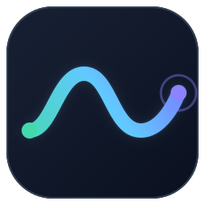
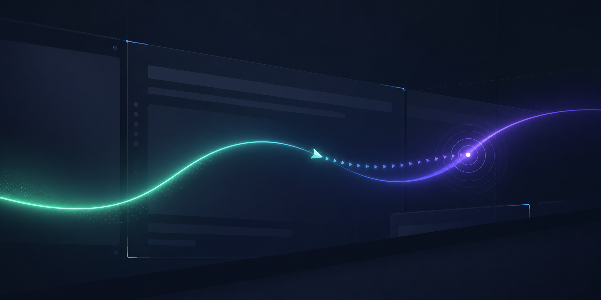
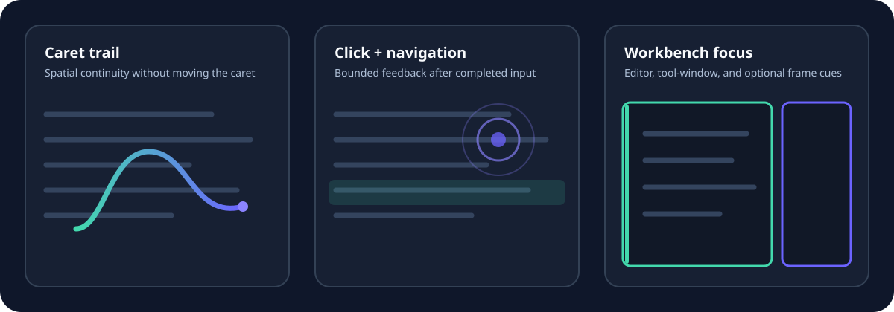
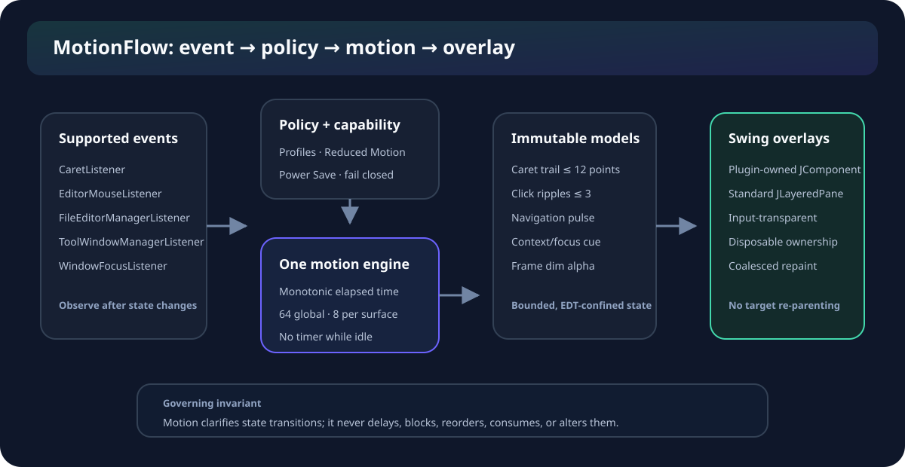

<p align="center">
  
</p>

<h1 align="center">MotionFlow</h1>

<p align="center">
  Smooth, native visual feedback for IntelliJ Platform IDEs—without delaying input or patching the IDE.
</p>

<p align="center">
  <a href="https://github.com/Myang-print/motionflow/actions/workflows/build.yml"></a>
  <a href="LICENSE"></a>
  <a href="https://github.com/Myang-print/motionflow/releases"></a>
  
</p>



MotionFlow observes completed IDE state changes and renders brief, input-transparent cues. The platform remains authoritative: motion never consumes events, moves the caret, changes documents, delays selection, or animates platform-owned layout geometry.

> **Status:** `0.2.3` release candidate. Automated package and compatibility gates are recorded in [release readiness](docs/evidence/release-readiness.md); signed Marketplace publication remains separately gated.

## Features

| Surface | Visual feedback | Safety behavior |
| --- | --- | --- |
| Editor | Silky continuous multi-caret trails | Independent exact-origin paths for up to 8 carets; projected vertical geometry, coverage, visibility, and style controls |
| Split editors | Direction-aware cross-pane caret flow | Reanchors the destination and samples one source-to-target path across the shared root |
| Editor | Click ripple | Primary-button click only; drag, popup, and right-click are ignored |
| Editor | Navigation pulse | Triggers only after a configurable large visual-line jump |
| Editor context | Selected-editor edge cue | No editor-tab traversal or geometry mutation |
| Tool windows | Focus outline | Observes activation; never resizes or delays the tool window |
| Project frame | Optional inactive-frame dim | Off by default; immediately cleared on focus, disable, or disposal |
| Control | Subtle, Balanced, Expressive, and Custom profiles | Live Apply, instant global toggle, independent effect switches |
| Accessibility | Reduced Motion and high-contrast simplification | Spatial effects stop; orientation cues are capped at 80 ms |
| Operations | Redacted local diagnostics | No telemetry, paths, project names, file names, or document text |



## Install

### From a GitHub release

1. Download `MotionFlow-0.2.3.zip` from [Releases](https://github.com/Myang-print/motionflow/releases).
2. In the IDE, open **Settings | Plugins**.
3. Select the gear menu, choose **Install Plugin from Disk…**, and select the ZIP.

### Build locally

Requirements: JDK 21; no global Gradle installation is required.

```powershell
git clone https://github.com/Myang-print/motionflow.git
cd motionflow
./gradlew.bat check verifyPluginProjectConfiguration verifyPluginStructure buildPlugin
```

The installable ZIP is written to `build/distributions/`.

## Use

Open **Settings | Appearance & Behavior | MotionFlow** to select a profile, enable Reduced Motion, tune editor/workbench effects, or run the isolated one-shot preview.

Find Action also exposes:

- **MotionFlow: Toggle Motion**
- **MotionFlow: Open Settings**
- **MotionFlow: Copy Diagnostics**

See the [user guide](docs/USER_GUIDE.md) and [troubleshooting guide](docs/TROUBLESHOOTING.md).

## Architecture



MotionFlow uses supported IntelliJ event APIs and standard JDK/Swing overlays. One application-level `javax.swing.Timer` advances every active timeline and stops when the registry becomes empty. Mutable animation state is EDT-confined and bounded to 64 global timelines, 8 per surface/editor, 12 points per trail, 3 ripples per editor, and 512 timing samples.

The implementation deliberately does **not** use CSS/JavaScript injection, reflection, internal APIs, Java agents, IDE-file modification, component re-parenting, UI-delegate replacement, or a process-wide AWT event hook.

Read the [PRD](docs/PRD.md), [implementation plan](docs/implementation/implement.md), [ADRs](docs/adr/), and [requirement traceability matrix](docs/traceability-matrix.md) for the complete engineering contract.

Release evidence is recorded in [automated validation](docs/evidence/automated-validation.md), [compatibility](docs/evidence/compatibility.md), and [performance/resource evidence](docs/evidence/performance.md).

## Compatibility

- Minimum platform: IntelliJ Platform 2025.3, build `253`
- Build target: IntelliJ IDEA 2025.3.6
- Toolchain: Java 21, Kotlin, Gradle 9.5.0
- Dependency: `com.intellij.modules.platform`

The classic plugin is designed for IntelliJ Platform products, but a product is listed as verified only after its Plugin Verifier and smoke-test cell is recorded. Remote development and true tab/layout animations are not advertised in the `0.2.x` line.

## Privacy and security

MotionFlow makes no network requests, collects no telemetry, reads no document text, and stores no workspace history. Diagnostics are constructed from a fixed schema and sanitized before copying. See [Privacy](PRIVACY.md) and [Security](SECURITY.md).

## Development

```powershell
./gradlew.bat check
./gradlew.bat verifyPluginProjectConfiguration
./gradlew.bat verifyPluginStructure
./gradlew.bat buildPlugin
./gradlew.bat verifyPlugin
./gradlew.bat runIde
```

Read [CONTRIBUTING.md](CONTRIBUTING.md) before changing an effect. Each feature must preserve lifecycle, accessibility, performance, privacy, and supported-API invariants—not merely look correct in one IDE.

## Inspiration and license

[VSCode Animations](https://github.com/BrandonKirbyson/VSCode-Animations) inspired the product direction. MotionFlow is an independent Swing/JBR implementation and copies no upstream code or artwork. Details are in [THIRD_PARTY_NOTICES.md](THIRD_PARTY_NOTICES.md).

Licensed under the [Apache License 2.0](LICENSE).
